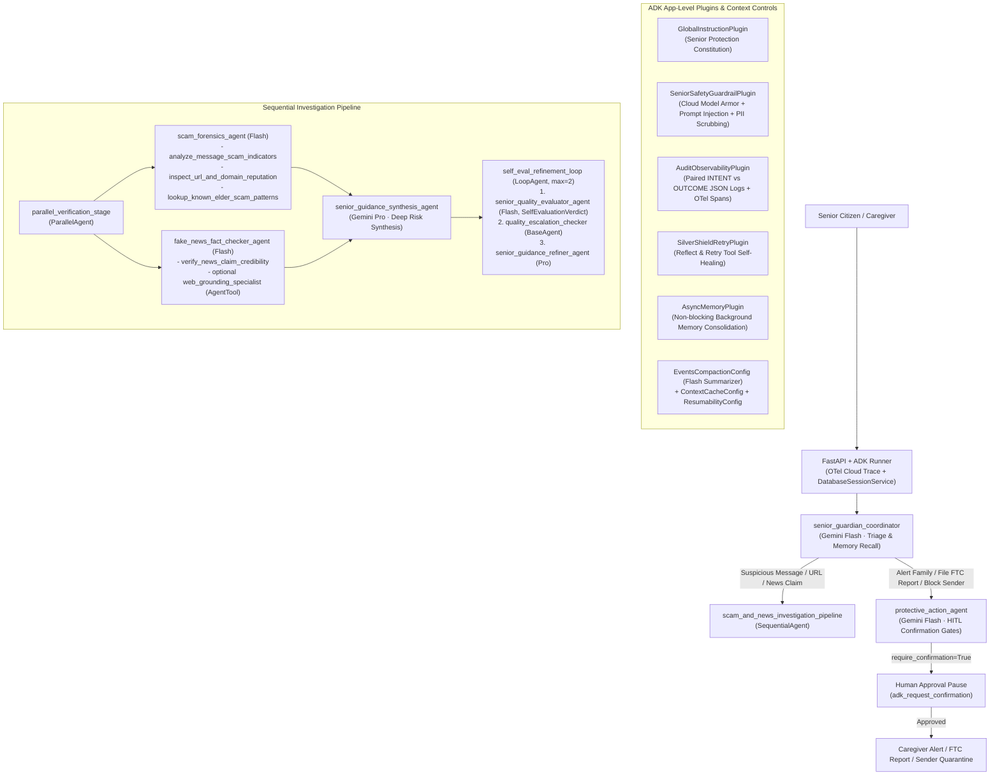

# SilverShield Guardian — AI Scam & Fake News Protection Agent for Senior Citizens

> **Track:** Agents for Good (Elder Protection & Digital Literacy)
> **Framework:** Google Agent Development Kit (ADK) · Python · FastAPI · OpenTelemetry · Terraform

**SilverShield Guardian** is a production-grade, multi-agent AI system built with Google's **Agent Development Kit (ADK)** to help senior citizens and their family caregivers safely evaluate suspicious text messages, phone call scripts, emails, links, and viral fake news/health claims — without fear, technical jargon, or shaming.

---

## Problem & Solution

Older adults lose billions of dollars each year to impersonation scams (IRS/Social Security arrest threats, Medicare phishing, AI voice-clone "grandparent" emergencies, tech-support pop-ups) and suffer real health and emotional harm from viral misinformation ("miracle cures doctors hide", fabricated benefit cancellations).

**SilverShield Guardian** acts as a calm, patient digital safety companion that:
1. Investigates suspicious messages, URLs, and viral claims in parallel using specialized ADK agents and deterministic forensic + fact-checking tools.
2. Reconciles findings using a reasoning-tier Gemini Pro synthesizer and audits its own reply through a self-evaluation loop for empathy, 6th-grade readability, and safety compliance.
3. Never shares or logs raw PII (SSNs, Medicare IDs, payment cards, PINs, phone numbers) thanks to an active Cloud DLP + local Luhn/regex PII scrubbing pipeline.
4. Enforces **Human-in-the-Loop (HITL)** confirmation stops before executing any high-stakes external action (notifying a family caregiver, filing a PII-redacted FTC report, or blocking a potentially personal/medical sender).

---

## Multi-Agent Architecture



---

## AgentOps Code Review Matrix Traceability (19 / 19 Criteria)

| Category | Criterion | Implementation Evidence |
| --- | --- | --- |
| **1. Tool & Interface Design** | Comprehensive Tool Docstrings | Exhaustive Google-style docstrings across all tools in `app/tools/scam_analysis.py`, `app/tools/fact_check.py`, `app/tools/knowledge_base.py`, `app/tools/memory_tools.py`, `app/tools/high_stakes_actions.py`. |
| | Descriptive Naming | Specific verb-noun names: `analyze_message_scam_indicators`, `inspect_url_and_domain_reputation`, `lookup_known_elder_scam_patterns`, `verify_news_claim_credibility`, `retrieve_senior_safety_history`, `notify_trusted_family_caregiver`, `file_official_ftc_scam_report`, `quarantine_suspicious_sender`. |
| | Explicit JSON Schemas | Strict Pydantic v2 `ConfigDict(extra="forbid")` request & response models in `app/schemas/tool_schemas.py` & `app/schemas/agent_schemas.py`, exported via `get_all_tool_json_schemas()` and `/api/tool-schemas`. |
| | Guided Error Handling | Every tool catches validation/parsing errors and returns `ToolErrorResult` with `error_code`, `recovery_instructions`, `suggested_next_tool`, and `retryable`, backed by `SilverShieldRetryPlugin(ReflectAndRetryToolPlugin)`. |
| **2. Context & Memory** | Robust System Instructions | Auditable Senior Protection Constitution in `app/prompts/constitution.py`, enforced globally via `GlobalInstructionPlugin` plus focused per-agent prompts. |
| | History Compaction | ADK `EventsCompactionConfig` (sliding window + token threshold with Gemini Flash `LlmEventSummarizer`), `ContextCacheConfig`, and `PIISafeHistoryCompactor` in `app/memory/compaction.py`. |
| | Persistent Session State | `DatabaseSessionService` (SQLite locally / Cloud SQL PostgreSQL in prod) & `VertexAiSessionService` in `app/memory/session_store.py`, plus persistent SQLite vector store + optional Vertex AI Search in `app/memory/knowledge_store.py`. |
| | Async Memory Operations | `AsyncMemoryConsolidator` (`app/memory/async_memory_manager.py`) & `AsyncMemoryPlugin` (`app/plugins/async_memory_plugin.py`) dispatch non-blocking background `asyncio.Task`s to scrub and consolidate cross-session memories without blocking the UI. |
| **3. Orchestration & Logic** | Multi-Agent Patterns | Coordinator (`LlmAgent`) + `SequentialAgent` + `ParallelAgent` + `LoopAgent` + custom `QualityEscalationChecker(BaseAgent)` in `app/agents/hierarchy.py`. |
| | Strategic Model Routing | `ModelRouter` (`app/config/model_router.py`) routes triage, forensics, fact-checking, compaction, and self-eval to **Gemini Flash** (`gemini-2.5-flash`) and escalates nuanced risk synthesis, refinement, and conflicting signals to **Gemini Pro** (`gemini-2.5-pro`). |
| | Guardrails & Policy Plugins | `SeniorSafetyGuardrailPlugin(BasePlugin)` (`app/plugins/safety_guardrail_plugin.py`) integrating Google Cloud Model Armor (with local deterministic fallback), prompt-injection blocking, PII prompt redaction, and self-eval output policy enforcement. |
| | Human-in-the-Loop Hooks | Native ADK `FunctionTool(..., require_confirmation=True)` on `notify_trusted_family_caregiver` and `file_official_ftc_scam_report`, conditional predicate `requires_quarantine_confirmation` on `quarantine_suspicious_sender`, and `ResumabilityConfig(is_resumable=True)`. |
| **4. Observability & Tracing** | Structured JSON Logging | `structlog` JSON renderer (`app/observability/logging.py`) in Google Cloud Logging schema (`severity`, `timestamp`, `logging.googleapis.com/trace`, `spanId`) with zero raw `print()` calls in `app/`. |
| | Intent vs. Outcome Capture | `AuditObservabilityPlugin(BasePlugin)` (`app/plugins/audit_observability_plugin.py`) logs paired `INTENT` (before) and `OUTCOME` (after/error) events linked by `action_id` with latency and divergence tracking. |
| | Distributed Tracing | OpenTelemetry SDK (`app/observability/tracing.py`) supporting Cloud Trace (`CloudTraceSpanExporter`), OTLP, and `otel_to_cloud=True` in `app/fast_api_app.py`, plus `traced_span` spans across tools, guardrails, and async memory. |
| | PII Redaction | `PIIRedactor` (`app/security/pii_redactor.py`) integrating Google Cloud DLP (`DlpServiceClient.deidentify_content`) + local Luhn/regex redactor across structured logs, memory writes, LLM prompts, and FTC reports. |
| **5. Infrastructure & CI/CD** | Automated Evaluation Suites | ADK `EvalSet` golden dataset (`tests/eval/evalsets/scam_and_fake_news.evalset.json`), `tests/eval/eval_config.json`, offline regression harness (`tests/eval/run_golden_eval.py`), and `tests/unit/` pytest suite. |
| | Infrastructure as Code | Complete Terraform stack (`deployment/terraform/`) provisioning Cloud Run v2, Cloud SQL PostgreSQL, Secret Manager, least-privilege IAM, Workload Identity Federation, GCS/BigQuery telemetry, and optional Discovery Engine, plus `Dockerfile`, `Makefile`, GitHub Actions CI/CD, and `agents-cli` / Agent Starter Pack integration. |
| | Secure Secret Management | `SecretManagerResolver` (`app/security/secrets.py`) fetching secrets from GCP Secret Manager via ADC + TTL caching, Cloud Run `secret_key_ref` mounts in Terraform, `.env.example`, and CI secret scanning. |

---

## Quick Start

### 1. Local Setup (using `uv`)

```bash
git clone https://github.com/matzie5/silvershield-guardian.git
cd silvershield-guardian
cp .env.example .env

# Install core + development dependencies
make install
```

Set your Gemini API key in `.env` (or authenticate with Vertex AI via `gcloud auth application-default login` and set `GOOGLE_GENAI_USE_VERTEXAI=TRUE`):

```bash
export GOOGLE_API_KEY="your-local-dev-key"
```

### 2. Run Locally with ADK Web UI or `agents-cli`

```bash
# Option A: Official ADK interactive playground
make playground
# Equivalent: uv run adk web .

# Option B: Google Agents CLI (Agent Starter Pack compatible)
uv tool install google-agents-cli
agents-cli info
agents-cli run "I got a text saying my Medicare card expires today and to click http://medicare-renew-benefits.xyz"
agents-cli playground

# Option C: Run production FastAPI server locally
make serve
# Health check: curl http://127.0.0.1:8080/healthz
# Tool JSON schemas: curl http://127.0.0.1:8080/api/tool-schemas
```

### 3. Run Unit Tests, Linting, Typechecking & Golden Evaluations

```bash
make lint        # Ruff static analysis
make typecheck   # Mypy strict typing
make test        # Full unit + ADK InMemoryRunner HITL & orchestration tests
make eval        # Offline golden regression evaluation suite (zero API billing)

# Live LLM-as-judge ADK evaluation (requires GOOGLE_API_KEY or Vertex AI auth)
make eval-live
# Or via agents-cli:
# agents-cli eval run --evalset tests/eval/evalsets/scam_and_fake_news.evalset.json
```

---

## Deploying to Google Cloud (Terraform + Secret Manager + Cloud Run)

SilverShield follows Google Cloud **Agent Starter Pack** and **`agents-cli`** best practices — zero hardcoded secrets, least-privilege service accounts, and full Terraform IaC:

```bash
# 1. Populate secrets in GCP Secret Manager (never store in Git or .tfvars)
echo -n "postgresql+asyncpg://user:pass@/silvershield_sessions?host=/cloudsql/PROJECT:REGION:INSTANCE" \
  | gcloud secrets versions add silvershield-guardian-session-db-url --data-file=-

# 2. Validate & provision infrastructure via Terraform
cp deployment/terraform/terraform.tfvars.example deployment/terraform/terraform.tfvars
make tf-init
make tf-validate
make tf-plan
terraform -chdir=deployment/terraform apply -var-file=terraform.tfvars

# 3. Alternatively deploy via Google Agents CLI
agents-cli deploy --project YOUR_GCP_PROJECT --region us-central1
```

---

## License

Apache License 2.0 — see [LICENSE](LICENSE).
